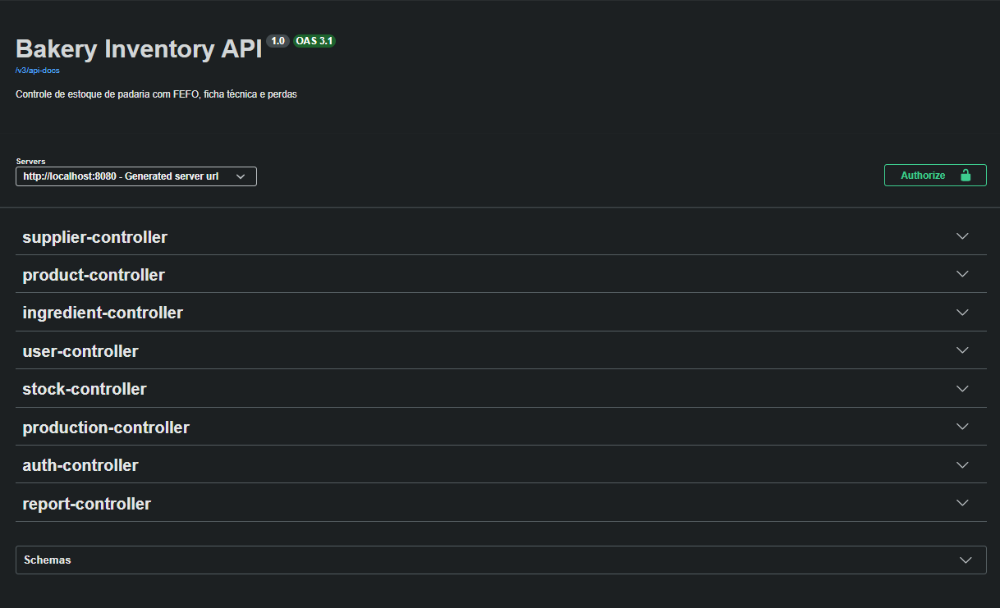

# Controle de Estoque para Padaria


Estou construindo uma API para controlar o estoque de uma padaria. A ideia é resolver
problemas que padaria tem de verdade: ingrediente que vence, receita que gasta vários
insumos de uma vez e desperdício que ninguém registra.

Este é um projeto de estudo, feito para aprender e praticar back-end com Java.
Ainda está em construção, e o que já funciona está marcado abaixo.

## O que a API faz (ou vai fazer)

- [x] Cadastrar e consultar insumos (farinha, açúcar, fermento...)
- [x] Cadastrar fornecedores
- [x] Registrar a entrada de mercadoria, com validade e custo
- [x] Cadastrar produtos e suas receitas (por massada)
- [x] Dar baixa nos insumos automaticamente quando algo é produzido, usando primeiro os lotes que vencem antes
- [x] Registrar perdas e avisar quando um lote está perto de vencer
- [x] Login e permissões por tipo de usuário
- [x] Relatórios de perdas, consumo e custo por produto
- [ ] Dados de exemplo para quem clonar o projeto
- [ ] Testes de integração com banco de verdade
- [ ] Publicar a API na internet

## Como a produção funciona

Em padaria, a receita é da **massada**: por exemplo, uma massada usa 30 kg de farinha e rende
cerca de 700 pães. Quando alguém registra uma produção, a API calcula quanto de cada insumo
foi gasto e tira do estoque sempre do lote que vence primeiro. Se faltar algum insumo, ela
avisa o que falta e não baixa nada. No final, devolve o custo da massada e o custo por pão.

## Tecnologias

Java 21, Spring Boot, SQL Server, Flyway, Docker, Spring Security com JWT e Swagger.

## Como rodar

Você precisa ter Java 21, Docker Desktop e Git instalados.

```bash
git clone https://github.com/LuisArtr/Projeto-Controle-Estoque-API.git
cd Projeto-Controle-Estoque-API

docker compose up -d
```

Espere uns 30 segundos e crie o banco (só na primeira vez):

```bash
docker exec -it bakery-db /opt/mssql-tools18/bin/sqlcmd -S localhost -U sa -P "Bakery@12345" -C -Q "CREATE DATABASE bakery"
```

Depois, rode a aplicação:

```bash
./mvnw spring-boot:run
```

No Windows, use `.\mvnw.cmd spring-boot:run`. A API fica em `http://localhost:8080`.

## Documentação

Com a aplicação rodando, abra `http://localhost:8080/swagger-ui.html`.



Para testar pelo Swagger, faça o login em `/auth/login`, copie o `token`, clique em
**Authorize** e cole só o token.

Primeiro acesso (apenas para desenvolvimento): `admin@bakery.local` / `admin123`.

## Quem pode fazer o quê

| Perfil | Permissões |
|---|---|
| Administrador | Tudo, incluindo usuários e relatórios |
| Estoquista | Insumos, fornecedores, entradas, perdas e consultas |
| Padeiro | Produção, perdas e consultas |

## Exemplo de uso

Primeiro, faça o login para pegar o token:

```bash
curl -X POST http://localhost:8080/auth/login \
  -H "Content-Type: application/json" \
  -d '{"email":"admin@bakery.local","password":"admin123"}'
```

Depois, use o token nas outras chamadas:

```bash
curl -X POST http://localhost:8080/ingredients \
  -H "Content-Type: application/json" \
  -H "Authorization: Bearer SEU_TOKEN_AQUI" \
  -d '{"name":"Farinha de trigo","baseUnit":"kg","minimumStock":50}'
```

## Configuração

As senhas padrão servem só para desenvolvimento. Em produção, defina as variáveis de
ambiente `ADMIN_PASSWORD`, `JWT_SECRET` (mínimo de 32 caracteres), `DB_URL`, `DB_USER`
e `DB_PASSWORD`.

## Sobre

Feito por Luis Artur. Estou começando na área e usando este projeto (com integração de AI
para desenvolvimento) para aprender na prática. Sugestões para o aprendizado são bem-vindas!